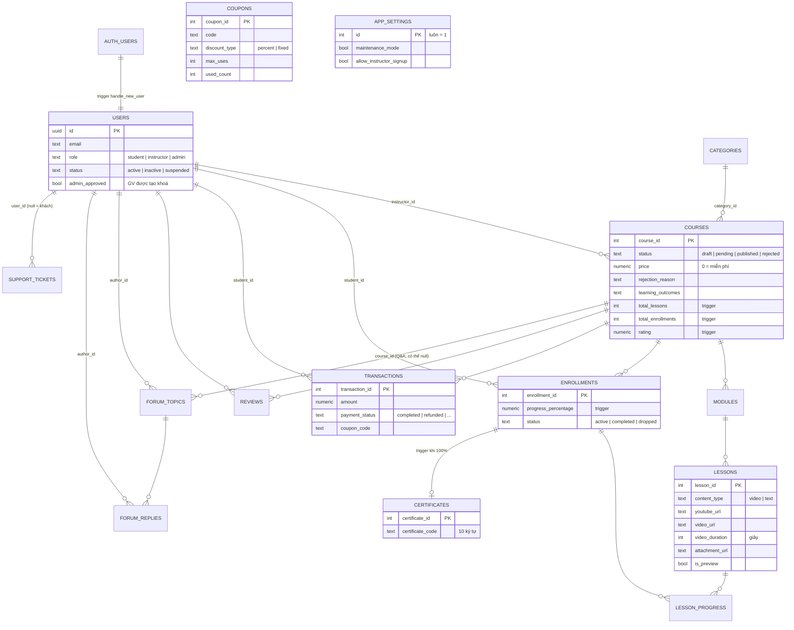

# ERD — VIAN Academy LMS (Supabase, SRS v2.0)

Nguồn: [`supabase_schema.sql`](../supabase_schema.sql) + [`supabase/migrations/20261122000000_srs_mvp.sql`](../supabase/migrations/20261122000000_srs_mvp.sql).
Bản ERD cũ (v1) ở [`legacy/ERD_v1.md`](legacy/ERD_v1.md).

## Bảng mới ở v2

| Bảng | Mục đích |
|---|---|
| `certificates` | Chứng chỉ do trigger cấp tự động khi hoàn thành 100%, xác thực công khai bằng mã |
| `coupons` | Mã giảm giá (%, số tiền cố định, giới hạn lượt dùng, hạn sử dụng); chỉ admin đọc/ghi, học viên kiểm tra mã qua `quote_checkout` |
| `app_settings` | Một dòng duy nhất: tên site, email/hotline hỗ trợ, chế độ bảo trì |
| `support_tickets` | Yêu cầu hỗ trợ (cả khách lẫn thành viên), admin phản hồi |

## View & RPC

| Tên | Loại | Ai gọi | Mô tả |
|---|---|---|---|
| `course_outline` | view | mọi người | Curriculum của khoá đã xuất bản, **không có URL video** |
| `quote_checkout(ids, coupon)` | RPC | mọi người | Tính giá, loại khoá đã sở hữu, kiểm tra mã giảm giá |
| `checkout(ids, coupon, method)` | RPC | đã đăng nhập | Tạo `transactions` + `enrollments`, cộng lượt dùng mã giảm giá |
| `refund_transaction(id)` | RPC | admin | Hoàn tiền và thu hồi quyền truy cập |
| `mark_solution(reply_id)` | RPC | người hỏi / GV / admin | Đánh dấu lời giải |
| `increment_topic_view(id)` | RPC | mọi người | Tăng lượt xem |
| `instructor_stats()` | RPC | GV | Doanh thu, học viên, theo tháng, theo khoá |
| `admin_stats()` | RPC | admin | Doanh thu theo kỳ/khoá/GV, người dùng, khoá học, hỗ trợ |

## Trigger

| Trigger | Bảng | Tác dụng |
|---|---|---|
| `on_auth_user_created` | `auth.users` | Tạo `users`; vai trò chỉ được là `student` hoặc `instructor` |
| `users_guard` | `users` | Người dùng không tự đổi `role`, `status`, `admin_approved`, `email` |
| `courses_guard` | `courses` | GV không tự xuất bản, không sửa bộ đếm; ghi `published_at` |
| `lessons_changed`, `modules_changed`, `enrollments_changed`, `reviews_changed` | | Tính lại `total_lessons`, `duration_hours`, `total_enrollments`, `rating` |
| `lesson_progress_after` | `lesson_progress` | Tính lại tiến độ → `completed` → cấp chứng chỉ |
| `forum_topics_guard`, `forum_replies_guard`, `forum_replies_count` | forum | Chỉ admin ghim/khoá, không tự đánh dấu lời giải, đếm số trả lời |

## Storage

| Bucket | Công khai | Ghi |
|---|---|---|
| `avatars` | Đọc công khai | Chủ sở hữu, đường dẫn `<uid>/…` |
| `thumbnails` | Đọc công khai | Chủ sở hữu, đường dẫn `<uid>/…` |
